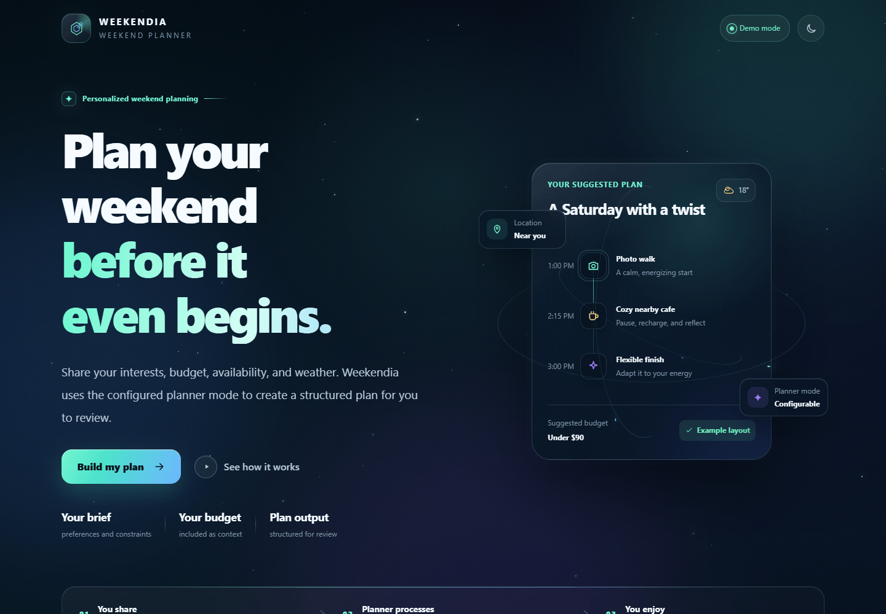
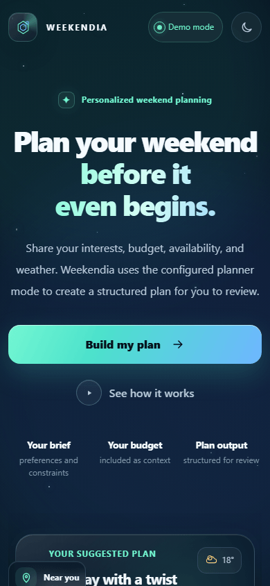
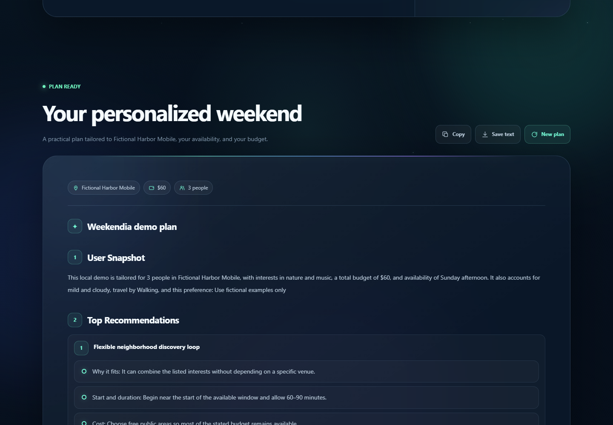
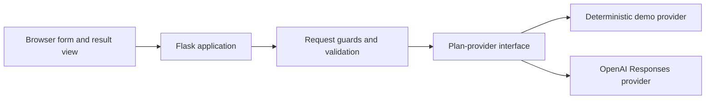

# Weekendia — Intelligent AI Weekend Planner

Weekendia turns a short set of preferences into a structured weekend itinerary that a person can review, adapt, and verify. It combines a responsive browser interface with a Flask API and an explicit provider boundary: use deterministic local demo mode for evaluation, or deliberately configure OpenAI mode for generated plans.

> **Repository status:** private evaluation only. No project-wide license is documented or verified, and the repository is not cleared for public release or redistribution. See [Rights and license status](#rights-and-license-status).

## Product preview

| Desktop planner | Mobile planner |
| --- | --- |
|  |  |



## What it does

- Collects location, interests, budget, group size, available time, weather, transport, and optional constraints.
- Validates and normalizes input in both the browser and server before provider execution.
- Returns a readable plan with recommendations, a schedule, a backup option, and a before-you-go checklist.
- Offers a deterministic, local-only demo provider that makes no model-provider request.
- Supports an explicitly configured OpenAI Responses API provider with bounded output, a 45-second timeout, no automatic retries, and `store=False`.
- Escapes provider text before rendering its supported Markdown subset, and supports copying or saving the plan as text.
- Includes light and dark themes, keyboard submission, visible focus treatment, live status announcements, reduced-motion behavior, and responsive layouts.

Weekendia does **not** have live venue, price, weather, transport, booking, or availability data. Every plan is a starting point; verify time-sensitive and safety-relevant details before leaving.

## Operating modes

| Mode | External model request | Intended use | Requirements |
| --- | --- | --- | --- |
| `demo` | No | Local interface, workflow, and deterministic-output evaluation | `WEEKENDIA_MODE=demo` |
| `openai` | Yes | Generated plans through the configured Responses API endpoint | API key, model identifier, and reviewed data handling |

Mode selection is explicit. An invalid or incomplete OpenAI configuration returns a configuration error; the application does not silently fall back to demo output.

## Architecture



The application factory keeps settings, provider selection, request guards, and plan generation injectable for testing. Read [Architecture](docs/ARCHITECTURE.md) and the [Technical deep dive](docs/TECHNICAL_DEEP_DIVE.md) for the complete design.

## Quick start

Prerequisites: Python 3.12, the validated runtime for this revision, plus an authorized checkout of this private repository.

### 1. Create an isolated environment

PowerShell:

```powershell
python -m venv .venv
.\.venv\Scripts\Activate.ps1
python -m pip install -r requirements.lock
```

POSIX shell:

```bash
python -m venv .venv
source .venv/bin/activate
python -m pip install -r requirements.lock
```

Use `requirements.txt` for the reviewed direct dependencies or `requirements.lock` for the exact runtime set validated with this revision.

### 2. Run local demo mode

PowerShell:

```powershell
$env:WEEKENDIA_MODE = "demo"
python main.py
```

POSIX shell:

```bash
WEEKENDIA_MODE=demo python main.py
```

Open `http://127.0.0.1:5000`. The bundled Flask server is for local development and evaluation, not an internet-facing deployment.

### 3. Configure OpenAI mode when needed

Set secrets through process environment variables or an appropriate secret manager. A local [`.env.example`](.env.example) documents every supported setting; if you copy it to `.env`, keep that file untracked and out of shared or synchronized storage.

```powershell
$env:WEEKENDIA_MODE = "openai"
$env:OPENAI_API_KEY = "<secret>"
$env:OPENAI_MODEL = "<approved-model-id>"
python main.py
```

Never commit an API key. Review the privacy section below before submitting real location, schedule, interest, or accessibility details.

## Configuration

Process-level variables take precedence over an optional `.env` file.

| Variable | Default | Purpose |
| --- | --- | --- |
| `WEEKENDIA_MODE` | `openai` | Selects `demo` or `openai`. |
| `OPENAI_API_KEY` | none | Required in OpenAI mode. |
| `OPENAI_MODEL` | none | Required model identifier in OpenAI mode. |
| `OPENAI_BASE_URL` | `https://api.openai.com/v1` | Responses-compatible endpoint; HTTPS is required except for loopback HTTP. |
| `OPENAI_PROXY_URL` | none | Optional HTTP(S) or SOCKS proxy; embedded credentials are rejected. |
| `WEEKENDIA_MAX_OUTPUT_TOKENS` | `1800` | Provider output bound, clamped to `1–4096`. |
| `WEEKENDIA_RATE_LIMIT_REQUESTS` | `12` | Plan requests allowed per local client key and process window. |
| `WEEKENDIA_RATE_LIMIT_WINDOW_SECONDS` | `60` | Per-process rate-limit window. |
| `WEEKENDIA_MAX_CONCURRENT_PLANS` | `4` | Simultaneous provider operations per process. |
| `FLASK_HOST` | `127.0.0.1` | Development-server bind address. |
| `FLASK_PORT` | `5000` | Development-server port. |
| `FLASK_DEBUG` | `false` | Local debugger switch; debug mode is refused for non-loopback binds. |

`OPENAI_MAX_OUTPUT_TOKENS` remains a legacy fallback only when `WEEKENDIA_MAX_OUTPUT_TOKENS` is absent.

## Validation

Install the development tools and run the local quality gates:

```powershell
python -m pip install -r requirements-dev.txt
python -m unittest discover -s tests -v
python -m compileall -q main.py weekendia tests
python -m ruff check .
python -m ruff format --check .
node --check static/script.js
node --check static/theme-init.js
```

Node.js is needed only for the JavaScript syntax check, not to run Weekendia. See the recorded [Validation report](docs/VALIDATION.md) for the checks performed on the private evaluation revision.

## Privacy and data handling

- Demo mode generates its plan inside the Flask process and does not send plan fields to a model provider.
- OpenAI mode sends the submitted fields and constructed prompt to the configured endpoint. Treat location, schedule, interests, and constraints as potentially sensitive.
- The Responses request sets `store=False`, which prevents default persistence of the Response object for later retrieval. It is not a zero-retention setting and does not eliminate every form of provider application state: prompt caching may temporarily retain encrypted cache tensors, and OpenAI abuse-monitoring logs may contain content for up to 30 days by default. Review OpenAI's [API data controls documentation](https://developers.openai.com/api/docs/guides/your-data) and your organization's settings.
- Weekendia has no plan database. The browser keeps the current plan in page memory; only the theme preference is stored in local storage. Saving a plan creates a text file on the user's device.
- Application error logs intentionally omit request bodies, prompts, provider URLs, exception messages, and tracebacks.

## Security and operational limits

The current controls reduce common local-evaluation risks; they do not make this a production deployment package.

- JSON input has field-specific limits and a 32 KiB request-body ceiling.
- API responses use private, no-store caching directives and request identifiers.
- Browser responses include a restrictive Content Security Policy and framing, content-type, referrer, permissions, and resource-policy headers.
- Cross-site POST requests identified by browser fetch metadata are rejected.
- Rate and concurrency controls are in-process only. They reset on restart and do not coordinate across workers or hosts.
- There is no user authentication, authorization, durable audit trail, distributed abuse control, or production deployment topology.
- `/api/health` reports local configuration state; it does not test provider reachability.
- HTTPS, authentication, shared rate limiting, monitoring, incident response, and deployment hardening remain responsibilities of any future approved hosting design.

For boundaries and assumptions, read the [Security model](docs/SECURITY_MODEL.md). Report suspected vulnerabilities through the private process in [SECURITY.md](SECURITY.md), not a general issue.

## Engineering notes

- Python modules separate environment parsing, prompt construction, provider adapters, and request guards from HTTP routing.
- The application factory supports provider and guard injection, allowing deterministic tests without external calls.
- Provider failures map to stable JSON error codes while logs retain only safe categories and request IDs.
- Browser behavior preserves an existing result when a later request fails and renders provider output through an allowlisted formatter.

Further reading:

- [User flows](docs/USER_FLOWS.md)
- [Case study](docs/CASE_STUDY.md)
- [Demo script](docs/DEMO_SCRIPT.md)
- [Decision records](docs/DECISIONS/README.md)
- [Roadmap](ROADMAP.md)

## Rights and license status

This repository intentionally has no `LICENSE` file. Source origin, contributor authority, visual-asset provenance, naming clearance, and project-wide licensing still require documented resolution. Dependency licenses govern their respective packages but do not license this project as a whole.

Keep the repository private. Do not publish, redistribute, sublicense, or commercialize it based on repository access alone. The detailed gate and evidence required for any status change are recorded in [License decision](docs/LICENSE_DECISION.md).

Weekendia is maintained for private evaluation under the **AIONEX project identity**. That wording identifies the current maintenance context; it is not a claim that AIONEX is the verified owner, original creator, or sole author.
