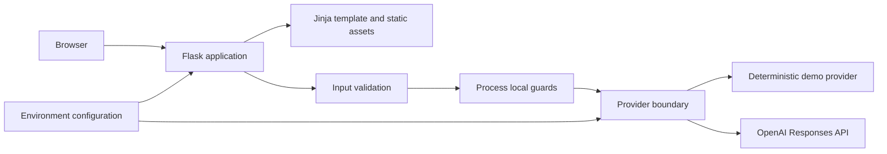
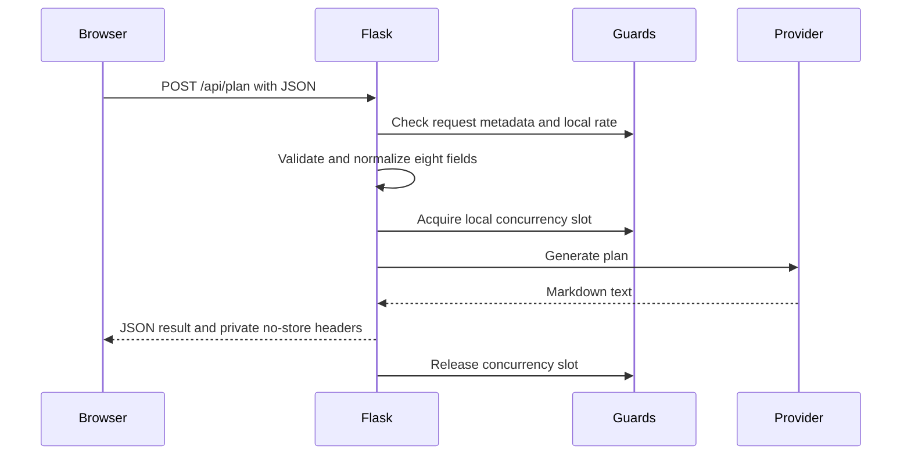

# Weekendia Architecture

> Status: private evaluation. AIONEX is the maintainer/project identity for this evaluation, not a verified owner. Source provenance, licensing, and name/logo clearance remain unresolved; no public release is authorized.

## System context

Weekendia is a server-rendered Flask application with a vanilla JavaScript client. It has two explicitly selected planning modes: a deterministic local demo and an OpenAI Responses API provider. The current repository contains no database, account system, job queue, analytics service, or live venue/weather integration.

The demo branch stays inside the application process. The OpenAI branch sends the eight submitted planning fields to an external provider. See [Security Model](SECURITY_MODEL.md) for the resulting trust boundary.

## Runtime components

| Component | Current responsibility |
| --- | --- |
| `main.py` | Application factory, routes, request IDs, request guards, error mapping, response headers, and development entry point |
| `weekendia/config.py` | Immutable settings, environment loading, bounded numeric values, and endpoint/proxy validation |
| `weekendia/planning.py` | Field normalization, server-side validation, and structured provider prompt construction |
| `weekendia/providers.py` | Provider protocol, deterministic demo implementation, and OpenAI Responses API implementation |
| `weekendia/guards.py` | Thread-safe, in-memory sliding-window and concurrency guards |
| `templates/index.html` | Accessible server-rendered application shell and form |
| `static/script.js` | Client validation, health display, submission, result rendering, and UI state |
| `static/theme-init.js` | Applies the saved theme before the interface is painted |
| `static/style.css` | Responsive themes, layout, focus states, reduced-motion behavior, and presentation |

## Plan request lifecycle

The implemented order is significant:

1. Assign or sanitize a request ID.
2. Reject a browser request explicitly marked `Sec-Fetch-Site: cross-site`.
3. Apply the process-local rate guard to `POST /api/plan`.
4. Reject a declared body above 32 KiB.
5. Require JSON, normalize fields, and enforce server-side field rules.
6. Acquire a non-blocking process-local concurrency slot.
7. Run the selected provider and map known failures to generic JSON errors.
8. Add security, cache, request-ID, and rate headers; release the slot during teardown.

## Configuration and provider selection

Process environment variables take precedence over an optional `.env` file. `WEEKENDIA_MODE` must be `demo` or `openai`; the application does not silently fall back between modes.

- `demo`: no provider credentials and no network call; output is deterministic for the same normalized input.
- `openai`: requires an API key and model. Remote base URLs require HTTPS; loopback HTTP is allowed for local compatible services. Embedded URL credentials are rejected.

The OpenAI client is currently configured with a 45-second timeout, zero SDK retries, a bounded output-token setting capped at 4096, and `store=False`. These are application controls, not deployment-level spend controls or a promise of zero provider retention.

## State and persistence

- The server does not intentionally persist form submissions or generated plans.
- Rate and concurrency state exists only in memory within one Python process.
- The browser keeps the selected theme in `localStorage`.
- The current result remains in page memory for copy/download until reset or navigation.
- OpenAI mode crosses an external-processing boundary; provider retention considerations are documented in the [Security Model](SECURITY_MODEL.md).

## Deployment boundary

`python main.py` starts Flask's development server. The code refuses to enable the interactive debugger on a non-loopback bind, but that does not make the development server suitable for public production use. No production WSGI topology, TLS termination, reverse-proxy trust policy, authentication layer, shared rate limiter, or provider budget enforcement is included.

## Verified and planned

Verified in code and automated tests:

- injectable Flask application and provider boundary;
- deterministic local demo behavior;
- structured validation and JSON error responses;
- OpenAI request bounds and `store=False`;
- process-local rate/concurrency guards and private API cache headers;
- generic health output that does not claim provider reachability.

Not implemented and therefore not claimed:

- live venue, price, availability, transport, or weather data;
- user accounts, saved plans, collaboration, or administration;
- multi-worker/distributed abuse controls;
- production hosting or internet-exposure controls;
- ownership, license, trademark, logo, or public-release clearance.

## Related documents

- [Technical Deep Dive](TECHNICAL_DEEP_DIVE.md)
- [Security Model](SECURITY_MODEL.md)
- [User Flows](USER_FLOWS.md)
- [Architecture decisions](DECISIONS/README.md)
