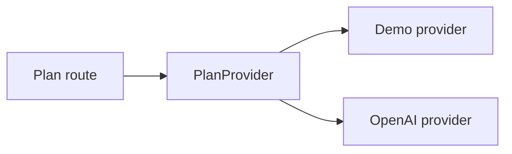

# ADR 0001: Isolate Plan Generation Behind a Provider Boundary

- Status: Accepted
- Date: 2026-08-08
- Scope: Private evaluation

## Context

Plan generation needs two different execution paths: a credential-free local demonstration and an externally processed OpenAI request. Route code must be testable without making a live provider call, and one mode must never be presented as the other.

## Decision

Define a small `PlanProvider` protocol with a `generate()` operation. Select exactly one implementation from validated settings:

- `DemoPlanProvider` creates deterministic text locally and makes no network call.
- `OpenAIPlanProvider` constructs the bounded Responses API request.

The Flask application factory also accepts an injected provider or generator for tests. Invalid modes and incomplete OpenAI settings fail explicitly; there is no silent fallback to demo mode.

## Consequences

Benefits:

- deterministic private demonstrations require no credential or external processing;
- provider behavior can be tested separately from routes;
- configuration and UI can disclose the selected processing mode;
- another provider can be evaluated without rewriting the HTTP contract.

Costs and limits:

- both implementations must preserve the same output and error expectations;
- a custom provider remains responsible for privacy, security, licensing, accuracy, and availability;
- the boundary does not provide provider portability automatically;
- there is still no production spend, quota, or multi-provider failover design.

## Verification

Automated tests confirm deterministic demo output, explicit mode configuration, injected route behavior, OpenAI request bounds, incomplete-response handling, and client closure. No live OpenAI or third-party compatibility test is claimed.

## Reconsider when

Revisit this ADR if the product introduces structured plan objects, streaming, queues, licensed live data, multiple active providers, or provider failover. Preserve explicit mode disclosure and a network-free test path.

