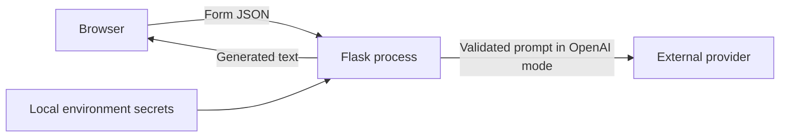

# Security and Privacy Model

> Assessment: hardened for local private evaluation, not approved for public internet exposure or described as production-ready. AIONEX is only the private-evaluation maintainer/project identity.

## Scope and assets

This model covers the Flask process, browser client, local configuration, submitted planning fields, generated text, and the optional OpenAI/provider connection. Important assets are provider credentials, user-entered context, provider budget, application availability, and the integrity of displayed plans.

No live customer dataset, production account, or deployed service is evidenced in this repository. Demo mode processes entered form text locally and performs no external processing; private evaluations should use fictional examples.

## Trust boundaries

- Browser to Flask is an untrusted input boundary.
- Flask to an external provider is a data-disclosure and availability boundary.
- Environment configuration is a privileged local boundary.
- A custom endpoint or proxy introduces an operator-selected third party whose practices are not verified by the application.

## Data flow by mode

### Demo mode

The server normalizes the eight form fields and produces deterministic text locally. It does not call OpenAI or another data provider. The server does not intentionally persist the submission or result. The browser retains the current result in page memory and stores only the theme choice in `localStorage`.

### OpenAI mode

The normalized location, interests, budget, group size, available time, weather, transportation, and constraints are included in a prompt sent to the configured provider. Users are instructed not to enter names, exact addresses, medical details, credentials, or other sensitive information.

The Responses API call sets `store=False`, preventing default persistence of the Response object for later retrieval. This is not a zero-retention guarantee and does not disable every form of provider application state. OpenAI's published [API data-controls documentation](https://developers.openai.com/api/docs/guides/your-data) describes temporary encrypted prompt-cache state and states that abuse-monitoring logs may be retained for up to 30 days by default, subject to account controls and applicable policy. Operators must review the current provider terms and their organization's data-control eligibility before handling real user data.

## Implemented controls

| Area | Verified implementation | Important limit |
| --- | --- | --- |
| Secrets | Credentials are read server-side from process environment or optional `.env`; values are not returned by health responses | Local secret storage, rotation, and host access remain operator responsibilities |
| Configuration | Process environment wins; remote base URL requires HTTPS; embedded URL credentials are rejected | A valid custom endpoint or proxy is not thereby trusted |
| Input | JSON-only route, 32 KiB body cap, per-field limits, scalar checks, null-byte removal, group bound | Free text remains untrusted and can be adversarial |
| Provider call | 45-second timeout, no SDK retries, output cap, `store=False`, completion check | No per-user budget, monthly spend ceiling, or provider-side quota policy |
| Availability | Process-local sliding-window and concurrency guards | State is not shared across workers/hosts and resets on restart |
| Browser boundary | Explicit cross-site Fetch Metadata POSTs are rejected | Requests without that header are not authenticated; this is not a complete CSRF or API authorization control |
| Output | Restricted client formatter escapes text before inserting markup | Generated advice may still be inaccurate, unsafe, or unsuitable |
| Errors and logs | Generic client errors; request ID and safe category logged without prompt/body/URL/exception text | Infrastructure and provider logs are outside this code's control |
| Browser headers | CSP, frame denial, no-sniff, referrer and permissions policies, same-origin resources | Headers do not replace TLS, a hardened host, or an edge policy |
| Cache | API responses are `no-store, private` | Browser extensions, screenshots, downloads, and upstream infrastructure may still retain content |
| Debug | Interactive debug mode is refused on a non-loopback bind | Flask's development server is still not a production server |

## Threats considered

- credential disclosure through source control, error messages, health metadata, or logs;
- oversized or malformed requests;
- prompt injection and instruction-like user input;
- provider timeout, failure, incomplete output, or unexpectedly high usage;
- cross-site browser submission;
- local denial of service and unbounded in-memory identity cardinality;
- active content or HTML injection in generated output;
- inaccurate plans presented as live facts;
- exposure of private submissions through caching.

The repository reduces these risks but does not eliminate them. In particular, the model cannot validate venue facts, safety conditions, accessibility, prices, transport, or weather.

## Internet-exposure blockers

Before any internet-facing deployment, all of the following require an explicit design and verification pass:

1. Add authentication or a deliberate anonymous-access policy with abuse ownership.
2. Enforce per-user quotas, provider spend ceilings, and emergency shutdown controls.
3. Put shared rate limiting and request filtering at a trusted edge; do not rely on process memory.
4. Deploy behind TLS with a production WSGI server and an explicit trusted-proxy policy.
5. Establish secret-manager storage, key rotation, least-privilege credentials, and incident revocation.
6. Define privacy notice, consent, retention, deletion, subject-request, and jurisdiction handling.
7. Review current provider retention and data-control settings; validate contracts for intended data classes.
8. Add safe operational telemetry without logging prompts or sensitive field values.
9. Perform dependency, SAST, DAST, penetration, accessibility, and failure-mode testing against the release artifact.
10. Resolve source provenance, dependency notices, license choice, and name/logo clearance before public distribution.

## Operational guidance for private evaluation

- Prefer `WEEKENDIA_MODE=demo` for demonstrations and UI review.
- Use fictional, non-sensitive inputs.
- Keep the server bound to loopback and debug disabled.
- Keep `.env` and credentials out of version control and synchronized public folders.
- Treat copied or downloaded plans as user-controlled data.
- Verify every real-world detail independently before acting on a plan.

## Security claims not made

The project does not claim formal compliance, zero data retention, end-to-end encryption, account isolation, production monitoring, verified uptime, certified accessibility, or safety of generated recommendations. It has no authentication and no evidence of a live production deployment.

## Related decisions

- [ADR 0001: Provider boundary](DECISIONS/0001-provider-boundary.md)
- [ADR 0002: Do not persist response objects by default](DECISIONS/0002-disable-response-storage.md)
- [ADR 0003: Private rights gate](DECISIONS/0003-private-rights-gate.md)
- [Release Checklist](RELEASE_CHECKLIST.md)
