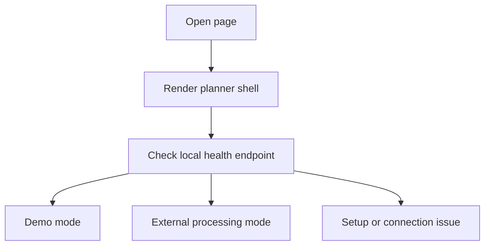
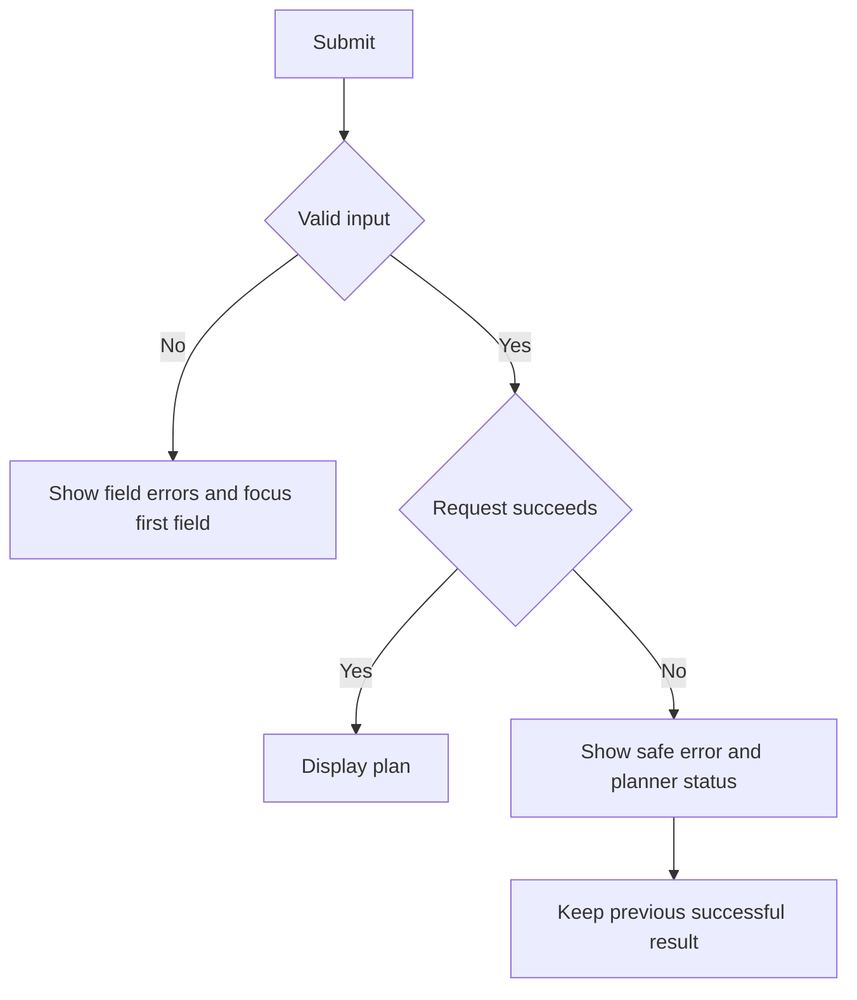

# User Flows

> These flows describe the current private-evaluation build. Weekendia has no accounts, saved-plan service, live-data feed, or production deployment.

## 1. Load and understand planner status

1. The server renders the application and a configuration-safe mode label.
2. The browser requests `GET /api/health` without caching it.
3. The header status reports local demo, configured external processing, setup required, offline, or degraded status.

The health endpoint reports configuration only. It does not contact or prove reachability of an external provider.

## 2. Create a plan

1. Move to the form directly or through the skip link.
2. Enter city/area, interests, total budget, group size, available time, expected weather, transportation, and optional constraints.
3. Optionally add interests with toggle chips and review the live form summary.
4. Submit with the button or `Ctrl+Enter`/`Command+Enter`.
5. Client validation focuses the first incomplete field. The server repeats authoritative validation after JSON submission.
6. A status region reports that the application is waiting for a response without presenting a fabricated percentage.
7. On success, focus moves to the result heading and a live-region message announces that the plan is ready.

In demo mode, the plan is deterministic and local. In OpenAI mode, the eight normalized fields cross the external-provider boundary. Neither mode verifies current prices, openings, availability, weather, transport, accessibility, or safety conditions.

## 3. Recover from a submission failure

- Field errors are associated with their inputs and announced through status regions.
- Configuration, capacity, timeout, offline, and generic failures use non-sensitive messages.
- A previous successful result stays available if a later request fails.
- The user can correct the form and submit again; local rate and concurrency guards may ask the user to wait.

## 4. Use a result

After a successful response, the user can:

- read the restricted Markdown-like presentation;
- copy the original plan text to the clipboard;
- download a UTF-8 text file containing basic plan metadata and the plan;
- choose **Create another plan**, which clears the result and form, then returns focus to location.

Copying or downloading moves plan content into user-controlled storage. The application provides no server-side history or deletion interface because it does not intentionally save plans.

## 5. Explore supporting controls

- **Theme:** switch between dark and light presentation. The preference is stored locally in the browser.
- **How it works:** open a short on-page explanation, close it with its button or `Escape`, and return focus to the originating control.
- **Reduced motion:** when the operating system requests reduced motion, scrolling and decorative effects are reduced.
- **Offline state:** existing on-page results remain readable, but creating a new plan still requires the local Flask connection.

## Verification boundaries

Automated tests cover server behavior, and browser smoke checks cover principal desktop and mobile interactions. This is not a formal usability study or accessibility certification. See [Validation](VALIDATION.md) for exact executed checks and limitations, and [Security Model](SECURITY_MODEL.md) for data-handling boundaries.
